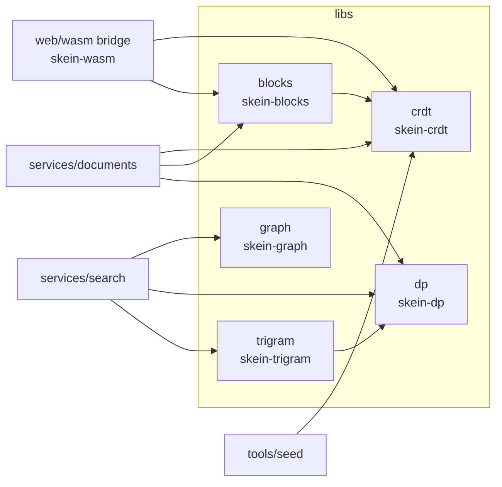

# Porting the libraries to Rust

The five Go libraries in `libs/` are pure: no I/O, no goroutines, no global
state, deterministic results, and a normative spec plus language-neutral
fixtures for each. They are the part of Skein to port first, and the part
where the computer science lives. Each library has its own guide next to
its code; this page ties them together.

Read [`docs/porting-to-rust.md`](../../porting-to-rust.md) first for the
language mapping and the per-package checklist. The services, platform and
generated code have their own porting notes (`docs/porting/README.md` and
the `PORTING.md` files under `services/`, `platform/` and `gen/`, written
separately).

## The guides

| Library | Rust crate | Guide | Spec | Fixtures | Supporting material | Reading | Port |
|---|---|---|---|---|---|---|---|
| `libs/crdt` | `skein-crdt` | [PORTING.md](../../../libs/crdt/PORTING.md) | [crdt-sequence.md](../../spec/crdt-sequence.md) | `testdata/conformance/crdt/` (7) | [Fugue by hand](crdt/fugue-by-hand.md) | ~10 h | 3–4 days |
| `libs/dp` | `skein-dp` | [PORTING.md](../../../libs/dp/PORTING.md) | [dp.md](../../spec/dp.md) | `testdata/conformance/dp/` (22) | | ~16 h | 4–5 days |
| `libs/blocks` | `skein-blocks` | [PORTING.md](../../../libs/blocks/PORTING.md) | [blocks.md](../../spec/blocks.md) | `testdata/conformance/blocks/` (14) | | ~6 h | 4–5 days |
| `libs/graph` | `skein-graph` | [PORTING.md](../../../libs/graph/PORTING.md) | [graph.md](../../spec/graph.md) | `testdata/conformance/graph/` (13) | | ~10 h | 4 days |
| `libs/trigram` | `skein-trigram` | [PORTING.md](../../../libs/trigram/PORTING.md) | [trigram.md](../../spec/trigram.md) | `testdata/conformance/trigram/` (17) | [Go regexp versus Rust regex](trigram/go-regexp-vs-rust-regex.md) | ~10 h | 5–6 days |

Effort is focused time for an engineer fluent in Rust and new to the
algorithm: reading before code, then porting the files, tests, fixtures,
fuzz targets and benchmarks. About 50 hours of reading and four to five
weeks of porting in all.

Every guide has the same six sections: what the library is and where Skein
uses it; what to read first (papers, articles, talks and reference code,
each mapped to the file it explains); the port order of every file with
its invariants and the tests and fixtures that prove it; dependencies and
their Rust equivalents; the Rust crate layout, public API, error enum and,
where the browser uses it, the WASM surface; and pitfalls with a
cross-checking plan against Go.

## Dependency graph

An arrow means "imports". Libraries import only the standard library and,
in two cases, each other; services and the browser bridge import
libraries, never the other way round.

What each consumer uses:

| Consumer | crdt | blocks | dp | graph | trigram |
|---|---|---|---|---|---|
| `services/documents` | op log, sync, history, undo | Markdown import and export, layout at a version, attributes, blame source map, link and block events | `Diff` RPC (patience lines, then characters) | | |
| `services/search` | | (through events) | fuzzy terms, title suggestions, snippets, reading plans | blast radius, paths, analysis, reading paths | the block, title and vocabulary indexes, regex and literal search, snapshots |
| `web/wasm` bridge | the browser replica | blocks, inline rendering, Markdown | | | planned offline search (ADR-0007) |
| `tools/seed` | generating histories | | | | |

`docs/porting-to-rust.md` section 2 lists `libs/trigram` as depending on
nothing; it imports `libs/dp` (`BestSnippet` and `Match`, for
`MakeSnippet`), as the graph above shows.

## Recommended order

1. **crdt.** The foundation of the product and of the browser client, and
   the only library with a sync wire format other code relies on. Porting
   it first also builds the shared pieces the others reuse: the uvarint
   codec with minimal-encoding checks, the fixture harness, seeded tests
   with `SKEIN_SEED`, and the habit of iterative tree walks. It is also
   the smallest library (about 1,200 lines of Go without tests; the others
   are 1,900 to 2,600).
2. **dp.** No dependencies, pure functions, and a gentle way to learn the
   spec-pinned tie-breaking style that every library uses. `skein-trigram`
   needs it. If you prefer a warm-up week, start here with the edit
   distances and LCS and do crdt second; nothing else changes.
3. **blocks.** Needs crdt. With crdt and blocks done, the whole WASM
   bridge can switch to Rust and the existing browser tests
   (`web/src/crdt/*.test.ts`) become an end-to-end check. Doing it before
   graph and trigram gets a visible result early.
4. **graph.** Independent of everything else; it can move anywhere after
   crdt. Classic algorithms (Tarjan, Kahn, Dijkstra, Brandes, PageRank,
   Louvain) with the most floating-point care.
5. **trigram.** Needs dp. Last because it has the most behaviour that
   differs between Go's and Rust's standard tools (the regex engines, case
   folding tables, roaring serialization), so it benefits most from the
   crosscheck habits built on the other four. It is also the closest to
   database internals: an inverted index, compressed bitmaps and a small
   query planner.

This differs from `docs/porting-to-rust.md` section 2 only in moving
blocks before graph, for the reason in step 3.

## Shared setup for all five crates

- **Workspace.** One Cargo workspace with `crates/skein-crdt`,
  `crates/skein-dp`, `crates/skein-blocks`, `crates/skein-graph`,
  `crates/skein-trigram` and later `crates/skein-wasm`. Edition 2024,
  `#![forbid(unsafe_code)]`, `cargo clippy -- -D warnings`.
- **Fixtures.** A small dev-only crate (`skein-conformance`) that finds
  `testdata/conformance/<name>/`, lists `*.json` in sorted order, and
  deserialises with `serde` and `#[serde(deny_unknown_fields)]`, so a
  misspelt key fails as the Go runners do. Each crate's
  `tests/conformance.rs` uses it.
- **Seeds.** Randomised tests log their seed and read `SKEIN_SEED` to
  replay, as in Go. Seeds are not portable between Go's PCG and
  `rand_pcg`; fixtures and crosscheck files are what the languages share.
- **Varints.** `crdt`, `blocks` and `trigram` all use minimal unsigned
  LEB128. Write it once (a `varint` module in `skein-crdt`, or a tiny
  crate) with tests for overlong and overflowing encodings.
- **Unicode.** Go 1.24 uses Unicode 15.0. `dp` (words), `blocks` (flanking,
  mentions) and `trigram` (folding, words, graphic characters) classify
  code points; use general categories (`unicode-general-category`) and
  `regex-syntax`'s folding, and check their Unicode versions.
- **Stacks.** Rust threads have fixed stacks (2 MiB for test threads, less
  in WASM). The Go code keeps deep walks iterative (crdt, graph); the
  guides list the places where Go still recurses (dp branch and bound,
  blocks' inline tree, trigram's regex analysis) and what to do.
- **Crosscheck data.** Each guide proposes Go-generated files under
  `testdata/crosscheck/<name>/` (random histories, regex queries, large
  graph results, index snapshots) for differential tests. They do not
  exist yet; `docs/porting-to-rust.md` section 6 plans `make crosscheck`
  for the first one.
- **Done.** A crate is done when the checklist in
  `docs/porting-to-rust.md` section 7 is ticked: crate docs, invariants
  after every operation, all Go tests ported by name, fixtures, fuzz
  targets with the Go seeds, golden bytes, cross-language replay where
  there is a format, and benchmarks recorded in `docs/PERF.md`.
